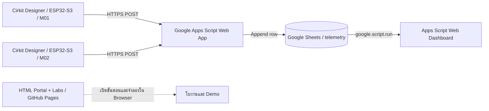

# 🏭 Smart Manufacturing IoT → Google Sheets → Web BI Dashboard

> **คู่มือการใช้งานชุดปฏิบัติการ 3 Interactive Labs** สำหรับนักศึกษาระดับปริญญาตรี  
> **เวลารวม:** ประมาณ 9 ชั่วโมง (Lab ละ 3 ชั่วโมง)  
> **กรณีศึกษา:** ติดตามเครื่องจักร 2 เครื่อง — **M01: CNC** และ **M02: Assembly**

## สารบัญ

1. [วัตถุประสงค์และผลลัพธ์การเรียนรู้](#1-วัตถุประสงค์และผลลัพธ์การเรียนรู้)
2. [สถาปัตยกรรมของระบบ](#2-สถาปัตยกรรมของระบบ)
3. [ไฟล์ภายในชุด Lab](#3-ไฟล์ภายในชุด-lab)
4. [สิ่งที่ต้องเตรียม](#4-สิ่งที่ต้องเตรียม)
5. [เริ่มใช้งาน Web Portal](#5-เริ่มใช้งาน-web-portal)
6. [Lab 01 — Hardware Design](#6-lab-01--hardware-design)
7. [Lab 02 — Cloud Upload](#7-lab-02--cloud-upload)
8. [Lab 03 — Web BI Dashboard](#8-lab-03--web-bi-dashboard)
9. [เผยแพร่ Lab ด้วย GitHub Pages](#9-เผยแพร่-lab-ด้วย-github-pages)
10. [ทดสอบและตรวจสอบความสำเร็จ](#10-ทดสอบและตรวจสอบความสำเร็จ)
11. [การแก้ปัญหาที่พบบ่อย](#11-การแก้ปัญหาที่พบบ่อย)
12. [ใบงานและการประเมินผล](#12-ใบงานและการประเมินผล)
13. [ข้อจำกัดและความปลอดภัย](#13-ข้อจำกัดและความปลอดภัย)

---

## 1. วัตถุประสงค์และผลลัพธ์การเรียนรู้

หลังจบชุดปฏิบัติการ ผู้เรียนควรสามารถ:

- ออกแบบวงจร ESP32-S3 เพื่อจำลองค่าการทำงานเครื่องจักร 2 เครื่องใน **Cirkit Designer**
- เชื่อมต่อ Potentiometer, Push Button และไฟ LED เข้ากับ ESP32-S3 ได้ตาม Pin Mapping
- ปรับพารามิเตอร์อุณหภูมิ/การสั่นสะเทือน ตรวจสถานะ `RUNNING`/`WARNING` และดูผลใน Serial Monitor
- กำหนดค่า HTTPS Endpoint ผ่าน **Google Apps Script** เพื่อบันทึก Telemetry ไปยัง **Google Sheets**
- เปรียบเทียบข้อมูล M01/M02 ด้วย Dashboard และเสนอแนวทางแก้ปัญหาจากหลักฐาน

**ความแตกต่างสำคัญ:** ปุ่มจำลองในหน้า Lab เป็น **Demo ใน Browser** ไม่ใช่หลักฐานการส่ง Cloud จริง ต้องตรวจข้อมูลใน Google Sheets และการตอบกลับจาก Endpoint อีกครั้ง

## 2. สถาปัตยกรรมของระบบ



> เว็บไซต์ Lab เปิดบนเครื่องนักศึกษาหรือ GitHub Pages ได้ ส่วน **Cloud Dashboard จริง** ทำงานภายใน Apps Script HTML Service แยกต่างหาก เพื่ออ่าน Google Sheets ผ่าน `google.script.run` และหลีกเลี่ยงปัญหา CORS

## 3. ไฟล์ภายในชุด Lab

```text
SmartFactory_Cirkit_3Labs/
├── README.md                         # คู่มือที่กำลังอ่าน
├── index.html                        # Web Portal
├── lab01.html                        # ออกแบบวงจรและเขียนโค้ด
├── lab02.html                        # ปรับค่าและส่งข้อมูลขึ้น Cloud
├── lab03.html                        # Dashboard จำลอง + ขั้นตอน Dashboard จริง
├── assets/
│   ├── style.css                     # หน้าตาเว็บ
│   └── app.js                        # Logic, ใบงาน, แบบทดสอบ, Demo
├── firmware/
│   └── smart_factory_esp32s3.ino     # Arduino Sketch สำหรับ ESP32-S3
└── cloud/
    ├── Code.gs                       # Google Apps Script: บันทึก Sheets / อ่านข้อมูล
    └── Dashboard.html                # Dashboard สำหรับ Apps Script HTML Service
```

**ห้ามแยกเฉพาะ `index.html` ไปอัปโหลด:** ต้องคงโครงสร้าง `assets/`, `cloud/`, `firmware/` และไฟล์ Lab ไว้ตามเดิม เพื่อให้ลิงก์และการทำงาน Interactive ไม่เสีย

## 4. สิ่งที่ต้องเตรียม

| รายการ | ใช้ทำอะไร |
|---|---|
| Chrome หรือ Edge รุ่นปัจจุบัน | เปิด Interactive HTML |
| อินเทอร์เน็ต | เปิด Cirkit Designer และ Google Apps Script |
| บัญชี Cirkit Designer | ออกแบบและจำลองวงจรที่ [cirkitdesigner.com](https://www.cirkitdesigner.com/) |
| บัญชี Google | Google Sheets, Apps Script และ Dashboard |
| Arduino Sketch ใน `firmware/` | ควบคุมเซนเซอร์จำลองและส่ง HTTPS |
| Google Sheets 1 ไฟล์ | เก็บข้อมูลของ M01 และ M02 ในชีต `telemetry` |

> ความพร้อมของรุ่นบอร์ด ไลบรารี และการเชื่อม Wi-Fi ใน Cirkit Designer อาจเปลี่ยนแปลงตามเวอร์ชัน Simulator ผู้สอนควรทดสอบกับบัญชีที่จะใช้สอนล่วงหน้า

## 5. เริ่มใช้งาน Web Portal

1. ดาวน์โหลด ZIP แล้ว **Extract All** / แตกไฟล์
2. เปิด `SmartFactory_Cirkit_3Labs/index.html` ด้วย Chrome หรือ Edge
3. คลิก Lab 01 → Lab 02 → Lab 03 ตามลำดับ
4. ตอบคำถามในแต่ละ Lab และบันทึกใบงานด้วยปุ่มที่กำหนด
5. กด **Export JSON** เพื่อเก็บใบงานก่อนเปลี่ยน Browser หรือล้างข้อมูล

ข้อมูลใบงาน/ข้อมูลจำลองส่วน Browser ใช้ **localStorage** จึงถูกเก็บแยกตาม Browser/อุปกรณ์ และอาจหายได้เมื่อล้าง Site Data หรือใช้โหมดไม่ระบุตัวตน ข้อมูลนี้ **ไม่ถูกส่งขึ้น Google Sheets อัตโนมัติ**

## 6. Lab 01 — Hardware Design

**เป้าหมาย:** สร้างวงจร 2 เครื่องจักรที่ใช้ ESP32-S3 แยกกัน และทดสอบการอ่านค่าที่ Serial Monitor

### 6.1 อุปกรณ์ต่อเครื่อง (ทำ 2 ชุด)

- ESP32-S3 × 1
- Potentiometer × 2: จำลอง Temperature และ Vibration
- Push Button × 1: จำลองการตรวจพบชิ้นงาน
- Green LED × 1 และ Red LED × 1
- ตัวต้านทานจำกัดกระแส LED (เช่น 220 Ω) × 2
- Breadboard และสายไฟ

### 6.2 Pin Mapping (ตรวจสอบ Pinout ของบอร์ดที่เลือก)

| อุปกรณ์ | GPIO | วิธีต่อหลัก |
|---|---|---|
| Potentiometer — Temperature | GPIO 4 | ขากลางไป ADC, ขานอกไป 3.3V/GND |
| Potentiometer — Vibration | GPIO 5 | ขากลางไป ADC, ขานอกไป 3.3V/GND |
| Push Button | GPIO 6 | ต่อกับ GND; ใช้ `INPUT_PULLUP` |
| Green LED | GPIO 15 | ผ่านตัวต้านทานจำกัดกระแสไป LED |
| Red LED | GPIO 16 | ผ่านตัวต้านทานจำกัดกระแสไป LED |

> **สำคัญ:** อย่าต่อ 5V เข้าขา Analog 3.3V ของ ESP32-S3 ให้ตรวจสอบ Pinout และความรองรับ ADC/GPIO กับบอร์ดที่ Cirkit Designer เลือกจริง

### 6.3 ขั้นตอนทำงาน

1. เปิด [Cirkit Designer](https://www.cirkitdesigner.com/) และสร้างโปรเจกต์ใหม่
2. เลือก ESP32-S3 ที่ Simulator รองรับ แล้วเพิ่มอุปกรณ์ตามรายการ
3. เชื่อมสายไฟตามตาราง **Pin Mapping** โดยต่อ GND ร่วมกัน
4. เปิดไฟล์ `firmware/smart_factory_esp32s3.ino` แล้วคัดลอก Sketch ไปยัง Code Editor ที่ใช้กับ Simulator
5. สำหรับเครื่องแรก ตั้ง `MACHINE_ID = "M01"`; สำหรับเครื่องที่สองสร้างวงจร/โปรเจกต์แยกและตั้ง `MACHINE_ID = "M02"`
6. Run Simulation แล้วเปิด Serial Monitor ที่ **115200 baud**
7. หมุน Potentiometer ทีละตัวเพื่อดูค่าที่อ่านได้ และกดปุ่มเพื่อทดสอบ `total_count`
8. บันทึกผลใน **Lab 01** และ Export ใบงาน JSON

**ค่าตัวอย่างใน Firmware:** `temperature = 20–100°C`, `vibration = 0–10 mm/s`; เมื่ออุณหภูมิ **มากกว่า 85°C** หรือการสั่นสะเทือน **มากกว่า 7 mm/s** สถานะเปลี่ยนเป็น `WARNING` และไฟแดงทำงาน

> หมายเหตุ: ในชุดนี้ค่าอุณหภูมิและการสั่นสะเทือนมาจาก **Potentiometer จำลอง** ไม่ใช่การอ่าน DHT22/เซนเซอร์สั่นจริง ส่วน `humidity` และค่าพลังงานบางส่วนเป็นข้อมูลเพื่อการสอน

## 7. Lab 02 — Cloud Upload

**เป้าหมาย:** เปลี่ยนค่าที่ Cirkit แล้วตรวจสอบว่ามีแถวใหม่ใน Google Sheets ของทั้ง M01 และ M02

### 7.1 สร้าง Google Sheets

1. ไปที่ [Google Sheets](https://sheets.google.com/) แล้วสร้างไฟล์ใหม่ชื่อ `SmartFactory_IIoT`
2. จาก URL รูปแบบ `https://docs.google.com/spreadsheets/d/SPREADSHEET_ID/edit` คัดลอกเฉพาะ `SPREADSHEET_ID`
3. ในชีต เลือก **Extensions → Apps Script**
4. นำโค้ดทั้งหมดจาก `cloud/Code.gs` ไปแทนเนื้อหาใน `Code.gs`
5. ใน Apps Script เปิด **Project Settings → Script Properties** แล้วเพิ่ม:

   | Property | ค่า |
   |---|---|
   | `SPREADSHEET_ID` | ID ของ Google Sheets ที่สร้าง |
   | `DEVICE_TOKEN` | สตริงสุ่มที่ใช้เฉพาะในห้องเรียน เช่นสร้างรหัสยาวแบบเดายาก |

6. เลือกฟังก์ชัน `setup` แล้วคลิก **Run** และยืนยันสิทธิ์ของ Google
7. ตรวจสอบว่ามีชีตชื่อ **`telemetry`** และมีหัวคอลัมน์ถูกสร้าง

**คอลัมน์ที่ระบบบันทึก:** `received_at`, `message_id`, `machine_id`, `temperature`, `humidity`, `vibration`, `energy_kw`, `machine_status`, `total_count`, `good_count`, `defect_count`

### 7.2 เพิ่มหน้า Dashboard ใน Apps Script

1. ที่ Apps Script เลือก **+ → HTML**
2. ตั้งชื่อไฟล์ว่า **`Dashboard`** (ไม่ต้องใส่นามสกุล `.html` ในช่องชื่อ)
3. คัดลอกเนื้อหาจาก `cloud/Dashboard.html` ไปวาง
4. บันทึกทั้งสองไฟล์

### 7.3 Deploy Web App

1. คลิก **Deploy → New deployment**
2. เลือกประเภท **Web app**
3. ตั้ง **Execute as: Me**
4. เลือก **Who has access: Anyone** *เฉพาะสำหรับข้อมูลจำลองที่ไม่เป็นความลับ*
5. คลิก Deploy และคัดลอก **Web App URL ที่ลงท้าย `/exec`**
6. ถ้ามีการแก้ `Code.gs` หรือ `Dashboard.html` หลัง Deploy ให้เลือก **Deploy → Manage deployments → Edit → New version** แล้ว Deploy ใหม่

**คำเตือนด้านความปลอดภัย:** Web App ในตัวอย่างนี้อนุญาตให้ผู้มี URL เปิด Dashboard ได้ และโค้ด ESP32 ฝัง `DEVICE_TOKEN` ไว้กับ Firmware ดังนั้นให้ใช้กับ **ข้อมูลสมมุติเท่านั้น** ห้ามเผยแพร่ Token ที่ใช้งานจริงลง GitHub และไม่ควรใช้โครงสร้างนี้กับข้อมูลโรงงานที่เป็นความลับ

### 7.4 ตั้งค่า ESP32-S3 ทั้งสองเครื่อง

แก้ไขส่วนต้นของ `firmware/smart_factory_esp32s3.ino`:

```cpp
const char* MACHINE_ID = "M01"; // เครื่องที่สองเปลี่ยนเป็น "M02"
const char* WIFI_SSID = "CirkitWifi";
const char* CLOUD_URL = "https://script.google.com/macros/s/YOUR_DEPLOYMENT_ID/exec";
const char* DEVICE_TOKEN = "YOUR_CLASSROOM_DEVICE_TOKEN";
```

- โปรเจกต์ M01 และ M02 ใช้ `CLOUD_URL` และ `DEVICE_TOKEN` เดียวกัน แต่ต้องมี `MACHINE_ID` ต่างกัน
- รัน Simulator และดู Serial Monitor ว่ามีการพยายามส่งข้อมูลทุกประมาณ **10 วินาที**
- ตรวจทั้ง HTTP Response และแถวที่เพิ่มขึ้นจริงในชีต `telemetry`
- ข้อความ `stored:true` เป็นสัญญาณรับข้อมูลจาก Script แต่หลักฐานสุดท้ายคือแถวที่ตรวจได้ใน Google Sheets
- หาก Cirkit Designer รุ่นที่ใช้งานไม่รองรับ HTTPS Redirect/TLS ตามโค้ดนี้ ให้บันทึกข้อจำกัดและทดสอบกับอุปกรณ์จริงหรือสภาพแวดล้อมที่รองรับ ไม่ควรสรุปว่าข้อมูลขึ้น Cloud แล้ว

### 7.5 ทดสอบเหตุการณ์ผิดปกติ

1. ตั้ง M01 อุณหภูมิประมาณ **60°C**, การสั่นประมาณ **2 mm/s** → ควรเป็น `RUNNING`
2. ปรับ M01 อุณหภูมิเกิน **85°C** → ควรเป็น `WARNING`
3. ตั้ง M02 อุณหภูมิปกติ แล้วปรับการสั่นเกิน **7 mm/s** → ควรเป็น `WARNING`
4. กดปุ่มจำลองชิ้นงานแล้วดู `total_count` เพิ่ม
5. ตรวจ Google Sheets ว่ามีข้อมูลทั้ง `M01` และ `M02` อย่างน้อยเครื่องละ 3 แถว พร้อมบันทึกเวลาที่ได้รับ

## 8. Lab 03 — Web BI Dashboard

**เป้าหมาย:** วิเคราะห์ข้อมูลเครื่องจักร 2 เครื่อง เปรียบเทียบค่าและตีความเหตุการณ์ `WARNING`

### ทางเลือก A: Dashboard Demo ใน Browser (ไม่ต้องมี Cloud)

1. เปิด `lab03.html`
2. คลิก **เพิ่มข้อมูลตัวอย่าง 24 จุด/เครื่อง** หรือใช้ข้อมูล Demo ที่บันทึกใน Lab 02
3. เปลี่ยนตัวกรอง **ALL / M01 / M02**
4. อ่านค่า KPI เช่น จำนวน Records, Average Temperature, Latest Warnings, Average Vibration
5. ดูกราฟอุณหภูมิและตาราง Telemetry แล้วเขียนข้อสรุปลงใบงาน

> **Demo ไม่อ่าน Google Sheets** และไม่ใช่ระบบ Real-time Cloud Dashboard

### ทางเลือก B: Dashboard จริงอ่านจาก Google Sheets

1. ทำ Lab 02 ให้ผ่านขั้นตอน Deploy แล้ว
2. เปิด URL Web App เดิมโดยเพิ่ม `?view=dashboard` เช่น:

   ```text
   https://script.google.com/macros/s/YOUR_DEPLOYMENT_ID/exec?view=dashboard
   ```

3. แอปจะเรียก `google.script.run.getDashboardData()` ภายใน Apps Script HTML Service เพื่ออ่านข้อมูลล่าสุดจากชีต `telemetry`
4. ตรวจว่า Dashboard แสดง Records ของ **M01** และ **M02**
5. กลับไปหมุน Potentiometer ใน Cirkit, ส่ง Telemetry ใหม่ แล้วรีเฟรช Dashboard
6. อธิบายว่าเครื่องใดเสี่ยงกว่า โดยอ้างอิงค่า Temperature/Vibration และช่วงเวลาที่เกิด `WARNING`

**คำถามวิเคราะห์:** เครื่องใดมีค่าอุณหภูมิเฉลี่ยสูงกว่า? เครื่องใดเกิด Warning มากกว่า? หากต้องตรวจเครื่องจักรเพียงหนึ่งเครื่องควรเริ่มจากเครื่องใด และเพราะเหตุใด?

> อย่านำจำนวนชิ้นงานเพียงอย่างเดียวไปคำนวณ **OEE** อย่างสมบูรณ์ เพราะต้องมีข้อมูลเวลาวางแผนผลิต เวลาหยุดเครื่อง และ Ideal Cycle Time เพิ่มเติม

## 9. เผยแพร่ Lab ด้วย GitHub Pages

**เหมาะสำหรับเผยแพร่ไฟล์ HTML ของ Portal และใบงาน** โดยไม่มีค่าใช้จ่ายโฮสติ้งสำหรับ Public Repository ตามข้อกำหนดบริการ ณ เวลาที่ใช้งาน

1. ไปที่ [github.com/new](https://github.com/new) สร้าง Public Repository ชื่อ `smart-factory-iot`
2. อัปโหลด `index.html`, `lab01.html`, `lab02.html`, `lab03.html`, `assets/` และไฟล์อื่นที่ไม่เป็นความลับ โดยรักษาโครงสร้างโฟลเดอร์เดิม
3. ไปที่ **Settings → Pages → Build and deployment**
4. เลือก **Deploy from a branch → main → / (root)** และ Save
5. เปิด URL รูปแบบ `https://USERNAME.github.io/smart-factory-iot/`

**อย่า Commit `DEVICE_TOKEN` จริงลง Public Repository**: โค้ดตัวอย่างใน `firmware/` ต้องคงค่า Placeholder ก่อนเผยแพร่  
**GitHub Pages รัน `Code.gs` ไม่ได้**: ต้อง Deploy Apps Script เป็น Web App แยกต่างหากตาม Lab 02

## 10. ทดสอบและตรวจสอบความสำเร็จ

| จุดตรวจ | ผลลัพธ์ที่ควรเห็น | สถานที่ตรวจ |
|---|---|---|
| เปิด Portal | เข้าถึง 3 Labs, CSS/JS โหลดครบ | `index.html` |
| ปรับค่าเซนเซอร์ | ค่าที่ Serial เปลี่ยนตาม Potentiometer | Cirkit Serial Monitor |
| เปลี่ยน Machine ID | ส่ง M01/M02 แยกกัน | Firmware / Sheet |
| Trigger WARNING | ไฟแดงและสถานะ `WARNING` | Cirkit Simulator |
| ส่ง Cloud | ได้ผลตอบรับและมีแถวใหม่จริง | Serial + Google Sheets |
| แก้ค่าหลังส่ง | Dashboard Cloud แสดงข้อมูลใหม่หลัง Refresh | Apps Script Dashboard |
| บันทึกใบงาน | ได้ไฟล์ JSON สำหรับส่งผู้สอน | Lab 01–03 |

## 11. การแก้ปัญหาที่พบบ่อย

| ปัญหา | จุดตรวจและแนวทางแก้ |
|---|---|
| หน้าเว็บไม่สวย / ปุ่มไม่ทำงาน | ตรวจว่า `assets/style.css` และ `assets/app.js` อยู่ในโฟลเดอร์เดียวกับที่ลิงก์ระบุ; แตก ZIP ทั้งชุด |
| อ่านค่า ADC ไม่เปลี่ยน | ตรวจขากลาง Potentiometer, 3.3V/GND, GPIO4/GPIO5 และบอร์ด ESP32-S3 ที่เลือก |
| ปุ่มนับชิ้นงานไม่ได้ | ตรวจ GPIO6, การต่อกับ GND และ `INPUT_PULLUP`; กดและปล่อยปุ่มใน Simulator |
| `CLOUD NOT CONFIGURED` | ใส่ `CLOUD_URL` และ `DEVICE_TOKEN` ใน Firmware ก่อน Run |
| Wi-Fi ไม่เชื่อม | ตรวจความสามารถของ Simulator รุ่นที่ใช้ และ SSID `CirkitWifi` |
| HTTP ขึ้น Error / Redirect / TLS | ตรวจ `/exec` URL, Deployment, Redirect และข้อจำกัดเครือข่ายจำลอง; **อย่าถือว่าขึ้น Cloud สำเร็จ** |
| Google Sheets ไม่มีแถว | ตรวจ `SPREADSHEET_ID`, `DEVICE_TOKEN`, การ Run `setup()` และสิทธิ์ Google; ดูคำตอบ `unauthorized` / `invalid ...` |
| Apps Script อัปเดตแล้วแต่ยังใช้โค้ดเก่า | **Manage deployments → Edit → New version → Deploy** |
| Dashboard ว่าง | ตรวจว่ามีแถวใน `telemetry` และ `Dashboard.html` ถูกเพิ่มใน Apps Script โปรเจกต์เดียวกัน |
| หน้า Lab 03 ไม่ตรงกับ Cloud | หน้า Lab 03 เป็น Demo ใน `localStorage`; ต้องเปิด Dashboard Cloud ผ่าน `/exec?view=dashboard` |
| เกิดข้อมูลซ้ำ | Server ใช้ `message_id` ช่วยตรวจซ้ำ; ตรวจ ID จาก Serial และชีต |

## 12. ใบงานและการประเมินผล

| Lab | สิ่งที่ส่ง | คะแนนแนะนำ |
|---|---|---:|
| Lab 01 | ภาพวงจร M01/M02, Pin Mapping, หลักฐาน Serial, ใบงาน JSON | 30 |
| Lab 02 | หลักฐาน Deploy, แถว Google Sheets ของทั้ง 2 เครื่อง, Warning Test, ใบงาน JSON | 40 |
| Lab 03 | ภาพ Cloud Dashboard, การเปรียบเทียบ M01/M02, ข้อเสนอแนะเชิงธุรกิจ, ใบงาน JSON | 30 |
| **รวม** | | **100** |

**แบบทดสอบ:** หน้า Lab มี Knowledge Check และการตรวจคำตอบภายใน Browser ตามที่เตรียมไว้  
**ข้อเสนอให้ผู้สอน:** ขอภาพประกอบ Serial Monitor และ Google Sheets ทั้งสองเครื่องเพื่อป้องกันการใช้ข้อมูล Demo แทนข้อมูลที่ส่งจริง

## 13. ข้อจำกัดและความปลอดภัย

- **ใช้ข้อมูลสมมุติเท่านั้น** — ไม่ใช้ข้อมูลพนักงาน ลูกค้า หรือกระบวนการผลิตที่เป็นความลับ
- ตัวอย่าง Firmware ใช้ `WiFiClientSecure::setInsecure()` เพื่อการเรียนการสอนใน Simulator ซึ่ง **ปิดการตรวจสอบใบรับรอง TLS**; ห้ามใช้แนวทางนี้กับ IoT ในระบบงานจริง
- การเปิด Apps Script Web App แบบ **Anyone** ทำให้หน้า Dashboard เข้าถึงได้โดยผู้มีลิงก์; Token เป็นเพียงมาตรการในห้องเรียน ไม่ใช่ระบบการยืนยันตัวตนระดับองค์กร
- Google Apps Script มี **Quota/ข้อจำกัดในการรับคำขอและ Redirect** จึงไม่เหมาะเป็น Industrial IoT Broker สำหรับระบบขนาดใหญ่
- ชุดนี้ยัง **ไม่ได้รับการยืนยันการทดสอบ End-to-End** ภายในบัญชี Cirkit Designer และ Google จริง ผู้สอนควรทดสอบกับเครื่องตัวอย่างหนึ่งเครื่องก่อนสอนทั้งห้อง
- หน้า Demo เก็บข้อมูลใน Browser ส่วนข้อมูลจริงอยู่ใน Google Sheets และอ่านผ่าน Dashboard ที่ Deploy บน Apps Script

---

### ลิงก์ที่ใช้

- [Cirkit Designer](https://www.cirkitdesigner.com/)
- [Google Sheets](https://sheets.google.com/)
- [Google Apps Script — Web Apps](https://developers.google.com/apps-script/guides/web)
- [Google Apps Script — HTML Service](https://developers.google.com/apps-script/guides/html)
- [GitHub Pages](https://pages.github.com/)

**ลำดับการสอนที่แนะนำ:** Hardware → Sensor Reading → HTTPS POST → Google Sheets → Cloud Dashboard → BI Analysis
>>>>>>> 730e0e1 (Update IoT Interactive Labs)
